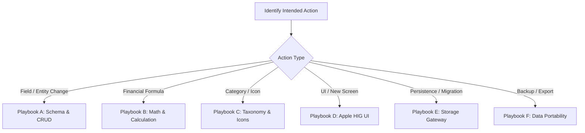

# Klyro Functional Features, File Catalog & Action Playbooks

Comprehensive mapping of every business capability in Klyro, linking each domain directly to its associated routes, UI components, hooks, storage services, utilities, data files, tests, and operational action playbooks.

---

## 1. Quick Feature-to-File Matrix

| Functional Domain | Route | Components Folder | Dedicated Hook(s) | Utilities & Services | Tests |
| :--- | :--- | :--- | :--- | :--- | :--- |
| **1. Dashboard & Financial Overview** | `src/app/index.tsx` | `src/components/home/` | `use-home-summary.ts`<br>`use-budget-health.ts`<br>`use-privacy-mode.ts` | `src/constants/formatters.ts`<br>`src/constants/breakdown.ts`<br>`src/data/initial-budget.json` | `src/utils/__tests__/csv-export.test.ts` |
| **2. Fixed Expenses & Credit Amortization** | `src/app/fixed-expenses.tsx` | `src/components/fixed-expenses/` | `use-fixed-expenses.ts`<br>`use-simulation-month.ts`<br>`use-expense-form.ts` | `src/utils/fixed-expenses.ts`<br>`src/utils/credit.ts`<br>`src/utils/auto-icon.ts`<br>`src/data/categories.json` | `src/utils/__tests__/fixed-expenses.test.ts`<br>`src/utils/__tests__/credit.test.ts` |
| **3. Variable Expenses & Multi-Month Smoothing** | `src/app/variable-expenses.tsx` | `src/components/variable-expenses/` | `use-variable-expenses.ts`<br>`use-expense-form.ts` | `src/utils/auto-icon.ts`<br>`src/constants/formatters.ts`<br>`src/data/categories.json` | `src/constants/__tests__/formatters.test.ts` |
| **4. Budget Simulator & Progressive Savings** | `src/app/details.tsx` | `src/components/details/` | `use-details-simulation.ts`<br>`use-simulation-month.ts` | `src/constants/breakdown.ts`<br>`src/utils/fixed-expenses.ts` | `src/constants/__tests__/breakdown.test.ts` |
| **5. Offline Persistence & Global State** | Transverse | App-wide (`src/app/_layout.tsx`) | `use-budget.tsx` | `src/services/budget-storage.service.ts`<br>`src/constants/storage.ts` | `src/services/__tests__/budget-storage.service.test.ts` |
| **6. Data Portability (JSON/CSV Backup & Restore)** | Modal on Home | `src/components/home/backup-modal.tsx` | `use-budget-backup.ts` | `src/utils/csv-export.ts`<br>`src/services/budget-storage.service.ts` | `src/utils/__tests__/csv-export.test.ts` |
| **7. Apple HIG Primitives, Theme & Haptics** | App-wide | `src/components/ui/`<br>`src/components/navigation-header.tsx`<br>`src/components/confirm-dialog.tsx` | `use-haptics.ts` | `src/theme/colors.ts`<br>`src/constants/theme.ts`<br>`src/lib/theme.ts`<br>`src/lib/utils.ts` | Lint / Audit |
| **8. Local Notifications & Alerts** | Background | Invoked from hooks | `use-fixed-expenses.ts` | `src/services/notifications.service.ts` | `src/services/__tests__/notifications.service.test.ts` |

---

## 2. Action Playbooks & Decision Trees

Use these exact paths and sequence of edits when performing common tasks.



---

### Playbook A: Add or Modify an Expense Field (Fixed or Variable)

When adding a property (e.g. `isTaxDeductible`, `recurrenceDay`, `notes`):

1. **Schema & Types:**
   * Modify [budget.ts](file:///c:/Users/bradl/Documents/projets/MyBudget/src/types/budget.ts) (`FixedExpense` or `VariableExpense` interface).
2. **Storage Migration & Validation:**
   * Update [budget-storage.service.ts](file:///c:/Users/bradl/Documents/projets/MyBudget/src/services/budget-storage.service.ts) to provide default values during state hydration if migrating older schemas.
3. **Form Hook:**
   * Update [use-expense-form.ts](file:///c:/Users/bradl/Documents/projets/MyBudget/src/hooks/use-expense-form.ts) (initial state, reset logic, validation rules).
4. **Modal UI:**
   * For fixed expenses: [fixed-expense-modal.tsx](file:///c:/Users/bradl/Documents/projets/MyBudget/src/components/fixed-expenses/fixed-expense-modal.tsx).
   * For variable expenses: [variable-expense-modal.tsx](file:///c:/Users/bradl/Documents/projets/MyBudget/src/components/variable-expenses/variable-expense-modal.tsx).
5. **Row Presentation:**
   * [fixed-expense-row.tsx](file:///c:/Users/bradl/Documents/projets/MyBudget/src/components/fixed-expenses/fixed-expense-row.tsx) or [variable-expense-row.tsx](file:///c:/Users/bradl/Documents/projets/MyBudget/src/components/variable-expenses/variable-expense-row.tsx).
6. **Verification:**
   * Run: `node scripts/audit-file.js src/types/budget.ts`
   * Run: `npx tsc --noEmit`

---

### Playbook B: Modify or Add Financial Calculations & Metrics

When modifying disposable income, savings distribution, credit progress, or debt ratios:

1. **Pure Helper Implementation (< 35 LOC):**
   * Credit / Amortization / Debt ratio: [credit.ts](file:///c:/Users/bradl/Documents/projets/MyBudget/src/utils/credit.ts).
   * Fixed expenses active status / dates: [fixed-expenses.ts](file:///c:/Users/bradl/Documents/projets/MyBudget/src/utils/fixed-expenses.ts).
   * Subsistence / Progressive savings formulas: [breakdown.ts](file:///c:/Users/bradl/Documents/projets/MyBudget/src/constants/breakdown.ts).
2. **Unit Tests (Deterministic):**
   * Write or update tests in [credit.test.ts](file:///c:/Users/bradl/Documents/projets/MyBudget/src/utils/__tests__/credit.test.ts) or [fixed-expenses.test.ts](file:///c:/Users/bradl/Documents/projets/MyBudget/src/utils/__tests__/fixed-expenses.test.ts).
   * Run: `npm test`
3. **Reactive Consumer Hooks:**
   * Home dashboard summary: [use-home-summary.ts](file:///c:/Users/bradl/Documents/projets/MyBudget/src/hooks/use-home-summary.ts).
   * Budget health & alerts: [use-budget-health.ts](file:///c:/Users/bradl/Documents/projets/MyBudget/src/hooks/use-budget-health.ts).
   * Interactive simulator: [use-details-simulation.ts](file:///c:/Users/bradl/Documents/projets/MyBudget/src/hooks/use-details-simulation.ts).
4. **UI Visual Presentation:**
   * Hero card: [home-balance-card.tsx](file:///c:/Users/bradl/Documents/projets/MyBudget/src/components/home/home-balance-card.tsx).
   * Trend chart: [budget-trend-chart.tsx](file:///c:/Users/bradl/Documents/projets/MyBudget/src/components/home/budget-trend-chart.tsx).
   * Simulator card: [simulation-summary-card.tsx](file:///c:/Users/bradl/Documents/projets/MyBudget/src/components/details/simulation-summary-card.tsx).

---

### Playbook C: Add or Modify Expense Categories & Auto-Icon Detection

When adding a new spending category or enhancing keyword recognition:

1. **Taxonomy & Colors Data:**
   * Edit [categories.json](file:///c:/Users/bradl/Documents/projets/MyBudget/src/data/categories.json) to declare the category, label, default color, and associated Ionicons.
2. **Keyword Matcher Utility:**
   * Update [auto-icon.ts](file:///c:/Users/bradl/Documents/projets/MyBudget/src/utils/auto-icon.ts) to map keywords (e.g. "netflix", "salaire", "carrefour") to category and icon.
3. **Modal Form Integration:**
   * Category inference automatically hooks into [use-expense-form.ts](file:///c:/Users/bradl/Documents/projets/MyBudget/src/hooks/use-expense-form.ts) upon title input change.
4. **Verification:**
   * Check icon rendering in [fixed-expense-row.tsx](file:///c:/Users/bradl/Documents/projets/MyBudget/src/components/fixed-expenses/fixed-expense-row.tsx) and [variable-expense-row.tsx](file:///c:/Users/bradl/Documents/projets/MyBudget/src/components/variable-expenses/variable-expense-row.tsx).

---

### Playbook D: Create or Update an Apple HIG UI Component / Modal

When creating a new screen widget or modal:

1. **Audit & Reusable Primitives:**
   * Reuse primitives in [src/components/ui/](file:///c:/Users/bradl/Documents/projets/MyBudget/src/components/ui/): `card.tsx`, `button.tsx`, `badge.tsx`, `input.tsx`, `text.tsx`.
   * Enforce Apple HIG: minimum $44 \times 44\text{ pt}$ touch targets (`hitSlop={8}` for smaller visual icons).
   * Implement all 4 async states: nominal, skeleton loading (`loading-state.tsx`), empty state, and error alerts.
2. **Component File Location:**
   * Place domain components strictly within their respective folder (`src/components/home/`, `src/components/fixed-expenses/`, `src/components/variable-expenses/`, `src/components/details/`).
3. **Register Barrel Export:**
   * Export the new component in `index.ts` of the corresponding folder.
4. **Haptic Feedback:**
   * Use [use-haptics.ts](file:///c:/Users/bradl/Documents/projets/MyBudget/src/hooks/use-haptics.ts) on interactive buttons, switches, and sheet dismissals.
5. **Screen / Route Wiring:**
   * Import into the route in [src/app/](file:///c:/Users/bradl/Documents/projets/MyBudget/src/app/). The route must remain an orchestrator (`< 150` LOC) delegating logic to hooks and display to components.

---

### Playbook E: Update Offline Storage & State Persistence

When changing data persistence or structure:

1. **Storage Gateway Contract:**
   * All reads and writes must pass exclusively through [budget-storage.service.ts](file:///c:/Users/bradl/Documents/projets/MyBudget/src/services/budget-storage.service.ts). Never call `AsyncStorage` directly inside hooks or components.
2. **Storage Key Configuration:**
   * Check or add keys in [storage.ts](file:///c:/Users/bradl/Documents/projets/MyBudget/src/constants/storage.ts).
3. **Context Provider:**
   * Integrate storage actions into [use-budget.tsx](file:///c:/Users/bradl/Documents/projets/MyBudget/src/hooks/use-budget.tsx). Ensure all mutation functions (`updateIncome`, `addFixedExpense`, etc.) trigger atomic persistence.
4. **Defensive Hydration:**
   * Ensure fallbacks to [initial-budget.json](file:///c:/Users/bradl/Documents/projets/MyBudget/src/data/initial-budget.json) or empty state arrays if stored JSON is corrupt.
5. **Unit Test Verification:**
   * Run: `npm test src/services/__tests__/budget-storage.service.test.ts`

---

### Playbook F: Data Portability (CSV Export, JSON Backup & Restore)

When modifying backup formats or adding export columns:

1. **CSV Formatter:**
   * Edit [csv-export.ts](file:///c:/Users/bradl/Documents/projets/MyBudget/src/utils/csv-export.ts). Keep RFC-4180 compatibility, UTF-8 BOM, and escaped quotes.
   * Update [csv-export.test.ts](file:///c:/Users/bradl/Documents/projets/MyBudget/src/utils/__tests__/csv-export.test.ts).
2. **Backup Hook:**
   * Edit [use-budget-backup.ts](file:///c:/Users/bradl/Documents/projets/MyBudget/src/hooks/use-budget-backup.ts) for handling file system interactions and validation of restored JSON payloads.
3. **Modal UI:**
   * Wire triggers and feedback alerts into [backup-modal.tsx](file:///c:/Users/bradl/Documents/projets/MyBudget/src/components/home/backup-modal.tsx).

---

## 3. Exhaustive Project Directory Map

```text
src/
├── app/                                 # EXPO ROUTER SCREENS (Page-level orchestration only)
│   ├── _layout.tsx                      # Root layout, SafeArea, Theme & BudgetProvider
│   ├── index.tsx                        # [Feature 1] Dashboard & Financial Overview
│   ├── fixed-expenses.tsx               # [Feature 2] Fixed Expenses & Credit Schedule
│   ├── variable-expenses.tsx            # [Feature 3] Variable Expenses & Smoothing
│   └── details.tsx                      # [Feature 4] Budget Simulator & Allocations
├── components/                          # PRESENTATIONAL & INTERACTIVE VIEWS
│   ├── home/                            # [Feature 1 & 6] Dashboard widgets & backup modal
│   │   ├── home-header.tsx              # Top bar, privacy toggle, date pill, backup button
│   │   ├── home-balance-card.tsx        # Hero Reste à Vivre card & distribution bar
│   │   ├── home-accounts-card.tsx       # Dual Inset Grouped cards for accounts
│   │   ├── home-income-card.tsx         # Monthly net income input card
│   │   ├── budget-trend-chart.tsx       # 12-month SVG curve projection
│   │   ├── backup-modal.tsx             # JSON/CSV import & export modal sheet
│   │   └── index.ts                     # Barrel export
│   ├── fixed-expenses/                  # [Feature 2] Fixed expenses components
│   │   ├── fixed-expense-row.tsx        # Single expense card with badge & actions
│   │   ├── fixed-expense-modal.tsx      # Create/edit bottom sheet with credit switch
│   │   ├── fixed-expenses-stats.tsx     # Monthly total, averages, and debt ratio card
│   │   ├── fixed-expenses-month-selector.tsx # Stepper for M+0..M+12 simulation
│   │   ├── fixed-expenses-empty.tsx     # Apple HIG zero-data placeholder
│   │   └── index.ts                     # Barrel export
│   ├── variable-expenses/               # [Feature 3] Variable expenses components
│   │   ├── variable-expense-row.tsx     # Single variable charge with smoothing badge
│   │   ├── variable-expense-modal.tsx   # Create/edit bottom sheet with duration pills
│   │   ├── variable-expenses-stats.tsx  # Total smoothed monthly burden card
│   │   ├── variable-expenses-empty.tsx  # Empty state view
│   │   └── index.ts                     # Barrel export
│   ├── details/                         # [Feature 4] Budget simulator components
│   │   ├── simulation-tabs.tsx          # Segmented control: Recurring vs One-off
│   │   ├── simulation-controls-card.tsx # Revenue & variable threshold inputs
│   │   ├── simulation-summary-card.tsx  # Resulting pillars (Current/Savings) & math callout
│   │   └── index.ts                     # Barrel export
│   ├── ui/                              # [Feature 7] Apple HIG reusable primitives
│   │   ├── badge.tsx                    # Capsule badges with semantic color tints
│   │   ├── button.tsx                   # Accessible buttons with >= 44pt touch area
│   │   ├── card.tsx                     # Inset Grouped card container
│   │   ├── input.tsx                    # Form inputs with focus states
│   │   ├── loading-state.tsx            # Apple HIG skeleton loading placeholders
│   │   └── text.tsx                     # San Francisco typography wrappers
│   ├── confirm-dialog.tsx               # [Feature 7] Destructive & action confirmation modal
│   └── navigation-header.tsx            # [Feature 7] Unified midnight blue navigation bar
├── hooks/                               # REACTIVE STATE & BUSINESS ORCHESTRATION
│   ├── index.ts                         # Barrel export
│   ├── use-budget.tsx                   # [Feature 5] Central React Context & dispatchers
│   ├── use-home-summary.ts              # [Feature 1] Financial metrics aggregation
│   ├── use-budget-health.ts             # [Feature 1] Solvency score & financial health
│   ├── use-privacy-mode.ts              # [Feature 1] Masking sensitive numbers (•••• €)
│   ├── use-fixed-expenses.ts            # [Feature 2] Fixed charges CRUD & schedule queries
│   ├── use-variable-expenses.ts         # [Feature 3] Variable charges CRUD & smoothing
│   ├── use-expense-form.ts              # [Feature 2 & 3] Modal inputs state & auto-category
│   ├── use-simulation-month.ts          # [Feature 2 & 4] M+0..M+12 temporal offset hook
│   ├── use-details-simulation.ts        # [Feature 4] Real-time math allocation orchestrator
│   ├── use-budget-backup.ts             # [Feature 6] JSON & CSV import/export orchestration
│   └── use-haptics.ts                   # [Feature 7] iOS tactile feedback trigger
├── services/                            # PERSISTENCE & SYSTEM INTEGRATIONS
│   ├── index.ts                         # Barrel export
│   ├── budget-storage.service.ts        # [Feature 5] Sole AsyncStorage gateway
│   ├── notifications.service.ts         # [Feature 8] Local notification scheduler
│   └── __tests__/                       # Service test suites
│       ├── budget-storage.service.test.ts
│       └── notifications.service.test.ts
├── utils/                               # PURE DETERMINISTIC HELPERS (< 35 LOC)
│   ├── index.ts                         # Barrel export
│   ├── auto-icon.ts                     # [Feature 2 & 3] Title keyword to icon/category matcher
│   ├── credit.ts                        # [Feature 2] Credit progress & debt ratio math
│   ├── fixed-expenses.ts                # [Feature 2] Active date predicates & expense sorters
│   ├── csv-export.ts                    # [Feature 6] RFC-4180 CSV serialization
│   └── __tests__/                       # Helper unit tests
│       ├── credit.test.ts
│       ├── csv-export.test.ts
│       └── fixed-expenses.test.ts
├── constants/                           # BUSINESS CONSTANTS & FORMATTERS
│   ├── index.ts                         # Barrel export
│   ├── breakdown.ts                     # [Feature 4] Allocation percentages & subsistence
│   ├── formatters.ts                    # [Feature 1] formatMoney & renderMoneyRound
│   ├── storage.ts                       # [Feature 5] AsyncStorage persistence keys
│   ├── theme.ts                         # [Feature 7] Theme spacing, radius, typography constants
│   └── __tests__/                       # Constant unit tests
│       └── breakdown.test.ts
├── data/                                # STATIC JSON SEED DATA & TAXONOMY
│   ├── index.ts                         # Barrel export
│   ├── categories.json                  # Expense categories with Ionicons and colors
│   └── initial-budget.json              # Default bootstrap budget state
├── types/                               # UNIVERSAL DOMAIN SCHEMAS
│   ├── index.ts                         # Barrel export
│   └── budget.ts                        # FixedExpense, VariableExpense, PersistedBudgetState
├── theme/                               # APPLE HIG DESIGN SYSTEM TOKENS
│   └── colors.ts                        # Slate/Navy palette, status tints, border colors
└── lib/                                 # INFRASTRUCTURE UTILITIES
    ├── theme.ts                         # Tailwind / NativeWind theme integration
    └── utils.ts                         # Class merging and styling helpers
```

---

## 4. Quality & Pre-Delivery Verification Commands

After completing any action playbook, systematically run the validation pipeline:

```bash
# 1. Audit modified file for LOC ceilings (< 35 fn, < 250 component, < 400 file) & zero 'any'
node scripts/audit-file.js <path-to-file>

# 2. Verify TypeScript typing
npx tsc --noEmit

# 3. Verify ESLint rules
npx expo lint

# 4. Run test suites
npm test
```
