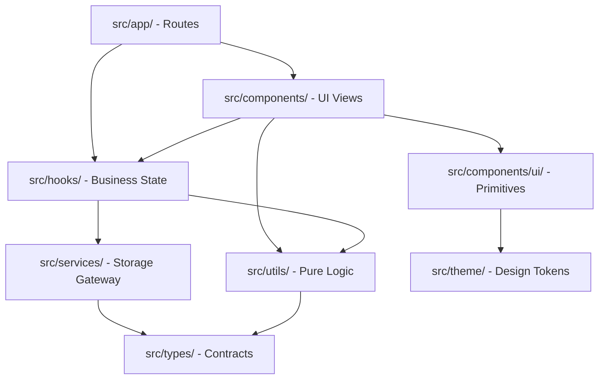

# Klyro Project Architecture & Design System

Comprehensive architectural blueprint, layer boundaries, unidirectional data flow, and SOLID principles for the Klyro / MyBudget codebase.

---

## 1. High-Level Architecture & Layer Separation

The project enforces a strict, screaming feature-first layered architecture. Every layer has a single responsibility and well-defined import boundaries:

```text
src/
├── app/                  # Route screens & tab layout (Expo Router file-based navigation)
├── components/           # UI components strictly separated by domain and primitives
│   ├── ui/               # Reusable primitives (Card, Button, Badge, Input, Skeletons)
│   ├── home/             # Dashboard widgets (Hero Reste à Vivre, Duo Comptes, Revenu)
│   ├── fixed-expenses/   # Fixed charges list, modal sheet, stats card, item rows
│   ├── variable-expenses/# Variable charges list, modal sheet, stats card, duration pills
│   ├── details/          # Simulator tabs, segmented control, allocation cards
│   ├── pay-and-save/     # Dedicated savings and payment orchestration components
│   ├── navigation-header.tsx # Unified midnight blue navigation bar
│   └── confirm-dialog.tsx# Accessible confirmation and deletion alerts
├── hooks/                # Reactive state, selectors, and business orchestration
│   ├── use-budget.tsx    # Central Context Provider & persistence gateway
│   ├── use-home-summary.ts       # Derived metrics for the dashboard
│   ├── use-fixed-expenses.ts     # CRUD, scheduling & credit logic
│   ├── use-variable-expenses.ts  # CRUD & multi-month smoothing
│   ├── use-details-simulation.ts # Real-time simulation & allocation math
│   ├── use-simulation-month.ts   # Timeline stepping & month presets (M+0..M+12)
│   ├── use-expense-form.ts       # Modal input state, validation & auto-detection
│   ├── use-privacy-mode.ts       # Application-wide persisted privacy toggle
│   ├── use-haptics.ts            # Apple HIG compliant tactile feedback
│   ├── use-budget-health.ts      # Solvency scoring & financial ratios
│   ├── use-budget-backup.ts      # Offline JSON import/export & state restoration
│   └── index.ts                  # Central hooks export barrel
├── services/             # Local data access (Offline persistence gateway)
│   └── budget-storage.service.ts # Sole accessor for @react-native-async-storage
├── utils/                # Pure, deterministic, side-effect-free helper functions (< 35 LOC)
│   ├── auto-icon.ts      # Semantic keyword detection for icons, categories & colors
│   ├── fixed-expenses.ts # Expense sorting, active status, date calculations
│   └── credit.ts         # Amortization, progression, debt ratio calculations
├── constants/            # Domain constants, category presets, default allocations
├── theme/                # Unified design system tokens, color palettes, and spacing
└── types/                # Strict TypeScript contracts and data models
```

---

## 2. Layer Boundary & Import Rules

To preserve architectural decoupling and avoid circular dependencies, strictly follow this import hierarchy:



### Prohibited Patterns
* ❌ **No storage calls in UI**: Components must never import `@react-native-async-storage/async-storage` or `budget-storage.service.ts` directly.
* ❌ **No business logic in routes**: `src/app/` files should only assemble screens by consuming hooks and rendering domain components.
* ❌ **No circular dependencies**: A utility or service must never import from hooks or components.

---

## 3. Unidirectional Data Flow

All persistent state flows down and mutations flow up through a predictable 4-step pipeline:

```text
[ AsyncStorage (Device Disk) ]
              │
              ▼  (1) Local Storage Gateway
[ BudgetStorageService (src/services/budget-storage.service.ts) ]
              │
              ▼  (2) Global Reactive Context
[ BudgetProvider (src/hooks/use-budget.tsx) ]
              │
              ▼  (3) Specialized Domain Selectors
[ Custom Hooks: useHomeSummary | useFixedExpenses | useVariableExpenses | useDetailsSimulation ]
              │
              ▼  (4) Presentation & User Interactions
[ Pure UI Components & Screens (src/components/ & src/app/) ]
```

1. **Storage Gateway (`BudgetStorageService`)**: Encapsulates atomic reads, writes, versioning, and defensive schema fallbacks.
2. **Context Provider (`BudgetProvider`)**: Maintains in-memory state, handles async initialization, and triggers disk writes on state changes.
3. **Domain Hooks**: Transform raw state into fine-grained derived data (e.g. smoothed expenses, savings allocations, active credits) with memoization.
4. **UI Components**: Receive primitives and callback triggers via props, remaining fully decoupled from storage implementation details.

---

## 4. SOLID Implementation Standards

| Principle | Application in Klyro | Concrete Example |
| :--- | :--- | :--- |
| **S (Single Responsibility)** | Components render; hooks manage state; utils compute math. Functions $< 35$ LOC, components $< 250$ LOC. | `use-home-summary.ts` calculates remaining budget; `home-hero-card.tsx` renders it. |
| **O (Open/Closed)** | Feature behavior can be extended without altering existing computation engines. | Adding new expense categories in `src/constants/` without modifying `auto-icon.ts` core engine. |
| **L (Liskov Substitution)** | Component primitives and models adhere to consistent structural contracts. | All skeleton loaders (`HomeSkeleton`, `ListSkeleton`, `DetailsSkeleton`) share layout semantics. |
| **I (Interface Segregation)** | Hooks expose granular selectors rather than monolithic global state objects. | Screens only consume the specific hook they need (`useFixedExpenses` instead of full context). |
| **D (Dependency Inversion)** | High-level presentation depends on storage abstractions, not concrete engines. | Views interact with `useBudget()` and never with low-level storage drivers. |

---

## 5. Render Optimization & React 19 Patterns

* **Memoization Strategy**:
  * Use `useMemo` for heavy aggregations (e.g. summing multi-month smoothed expenses or loan schedules).
  * Use `useCallback` on handlers passed to virtualized list items to prevent child re-renders.
* **List Virtualization**:
  * Unbounded collections (fixed expenses, variable expenses) must use `FlatList` with stable, unique IDs as keys.
  * Always define `keyExtractor={(item) => item.id}` outside the render loop.
* **Styling Hygiene**:
  * Rely on NativeWind v4 utility classes (`className="..."`).
  * Avoid creating dynamic inline style objects `{ margin: ... }` inside list item renderers.
