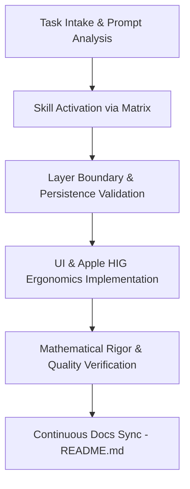

# Klyro Project Guidelines & Skill Orchestrator

Universal personal budget management application built with Expo SDK 57 and React Native 0.86.
`AGENTS.md` is the central **Skill Orchestrator** for this workspace. It enforces the automatic activation and execution of domain skills located in `.agents/skills/`.

---

## 1. Project Skills Index & Quick Links

Every architectural domain and quality standard is encapsulated into a dedicated project skill:

| Skill Identifier | Direct Link | Domain & Core Invariant |
| :--- | :--- | :--- |
| **`expo-react-native`** | [SKILL.md](file:///c:/Users/bradl/Documents/projets/MyBudget/.agents/skills/expo-react-native/SKILL.md) | Expo SDK 57, React Native 0.86, Expo Router v4, CNG, dynamic SafeArea insets. |
| **`project-architecture`** | [SKILL.md](file:///c:/Users/bradl/Documents/projets/MyBudget/.agents/skills/project-architecture/SKILL.md) | 4-layer unidirectional architecture, strict SOLID, `< 250` LOC components, `< 35` LOC utils. |
| **`apple-hig-ux`** | [SKILL.md](file:///c:/Users/bradl/Documents/projets/MyBudget/.agents/skills/apple-hig-ux/SKILL.md) | Apple HIG, Inset Grouped, $\ge 44$ pt touch targets, 4 mandatory async UI states. |
| **`offline-persistence`** | [SKILL.md](file:///c:/Users/bradl/Documents/projets/MyBudget/.agents/skills/offline-persistence/SKILL.md) | 100% offline resilience, single gateway via `budgetStorageService`, defensive schema fallback. |
| **`financial-math`** | [SKILL.md](file:///c:/Users/bradl/Documents/projets/MyBudget/.agents/skills/financial-math/SKILL.md) | Pure math, progressive savings ($\sqrt{R \times N}$), rounded amounts prioritized on home. |
| **`file-audit`** | [SKILL.md](file:///c:/Users/bradl/Documents/projets/MyBudget/.agents/skills/file-audit/SKILL.md) | Automated validation script `node scripts/audit-file.js`, LOC ceilings, 0 `any`. |
| **`docs-continuous-sync`** | [SKILL.md](file:///c:/Users/bradl/Documents/projets/MyBudget/.agents/skills/docs-continuous-sync/SKILL.md) | Continuous proactive synchronization of `README.md` (badges, tree, formulas, commands). |

---

## 2. Skill Activation Gatekeeper & Routing Matrix

Before writing any code or answering domain queries, activate the matching skills based on target files and intent:

| Target Context & Globs | Primary Skill | Supporting Skills | Mandatory Invariants to Enforce |
| :--- | :--- | :--- | :--- |
| **Routes & Navigation**<br>`src/app/**`, `_layout.tsx` | `expo-react-native` | `project-architecture`<br>`apple-hig-ux` | • Zero business or presentation code in routes (delegate to `src/components/` and `src/hooks/`).<br>• Respect Safe Area insets dynamically with zero hardcoded offsets. |
| **UI Components & Screens**<br>`src/components/**` | `apple-hig-ux` | `project-architecture` | • Minimum $44 \times 44$ pt hit zones (`hitSlop` on small icons).<br>• 4 async states covered: nominal, loading (`HomeSkeleton`), empty, error.<br>• Inset Grouped cards with Apple radii (`rounded-3xl` / `rounded-2xl`). |
| **Hooks & State Flow**<br>`src/hooks/**` | `project-architecture` | `offline-persistence`<br>`financial-math` | • Strict memoization (`useMemo`, `useCallback`).<br>• No direct `AsyncStorage` calls inside UI hooks (delegate to services).<br>• Domain hooks isolated from presentation logic. |
| **Persisted Data & Storage**<br>`src/services/**`, schema | `offline-persistence` | `project-architecture` | • 100% offline operation without network requirements.<br>• Single read/write entry point: `budget-storage.service.ts`.<br>• Atomic updates with defensive fallbacks and `PersistedBudgetState` schema. |
| **Financial Rules & Formatters**<br>`src/utils/**`, `src/constants/**` | `financial-math` | `project-architecture` | • Pure functions only ($< 35$ LOC, zero side-effects).<br>• Savings allocation formula: $\sqrt{R \times N}$.<br>• Cognitive dual-display: rounded amounts prioritized on Home (`renderMoneyRound`). |
| **Audits & Pre-delivery**<br>Any modified file | `file-audit` | `project-architecture` | • Run `node scripts/audit-file.js <file>`.<br>• LOC limits: $< 35$ (fn), $< 250$ (component), $< 400$ (file).<br>• Strict typing: zero `any`, matching brackets and zero lint/type errors. |
| **Repository Structure & Docs**<br>`README.md`, dependencies | `docs-continuous-sync` | All skills | • Proactive synchronization of `README.md` after changes without waiting for user prompts. |

---

## 3. Multi-Skill Execution Lifecycle

Every implementation follows this sequential pipeline:



1. **Intake & Activation**: Match file patterns and user intent. Open and inspect relevant `SKILL.md` files before generating edits.
2. **Phase 1 — Boundaries & Persistence**: Enforce Layer 2/3 boundaries (`project-architecture`, `offline-persistence`).
3. **Phase 2 — Ergonomics & Visuals**: Apply Apple HIG design system, 4 async states, and touch target constraints (`apple-hig-ux`, `expo-react-native`).
4. **Phase 3 — Math & Verification**: Verify financial formulas, cognitive rounding priority, and clean compilation (`financial-math`, `file-audit`).
5. **Phase 4 — Living Sync**: Update `README.md` immediately if routes, hooks, components, or dependencies changed (`docs-continuous-sync`).

---

## 4. Verification & Quality Commands

Always validate workspace integrity before declaring a task complete:

```bash
node scripts/audit-file.js <path-to-file>   # Audit LOC ceilings & strict types
npx expo lint                              # ESLint verification
npx tsc --noEmit                           # TypeScript compilation
```
