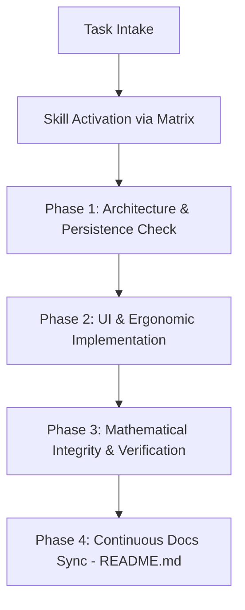

# Klyro Project Guidelines & Skill Orchestrator

Universal personal budget management application built with Expo and React Native.
`AGENTS.md` acts as the central **Skill Orchestrator** for the workspace, coordinating specialized project skills located in `.agents/skills/` across all development phases.

---

## 1. Project Skills Index (`.agents/skills/`)

Every development requirement and architectural domain is encapsulated into a dedicated, reusable project skill:

| Skill Identifier | Location | Domain & Purpose |
| :--- | :--- | :--- |
| **`expo-react-native`** | [SKILL.md](file:///.agents/skills/expo-react-native/SKILL.md) | Expo SDK 57, React Native 0.86, Expo Router navigation, CNG, standard CLI workflows, EAS. |
| **`project-architecture`** | [SKILL.md](file:///.agents/skills/project-architecture/SKILL.md) | Clean layer separation (`src/components/`, `src/hooks/`, `src/utils/`, `src/services/`), render optimization, list virtualization. |
| **`apple-hig-ux`** | [SKILL.md](file:///.agents/skills/apple-hig-ux/SKILL.md) | Apple Human Interface Guidelines, Inset Grouped design, 4 mandatory async UI states, touch ergonomics ($\ge 44$ pt). |
| **`offline-persistence`** | [SKILL.md](file:///.agents/skills/offline-persistence/SKILL.md) | 100% offline resilience, AsyncStorage gateway, schema versioning, atomic data mutations. |
| **`financial-math`** | [SKILL.md](file:///.agents/skills/financial-math/SKILL.md) | Pure mathematical calculations, savings formulas ($\sqrt{R \times N}$), multi-month smoothing, credit progression. |
| **`file-audit`** | [SKILL.md](file:///.agents/skills/file-audit/SKILL.md) | Deterministic code audit, LOC ceilings, strict typing, layer isolation, Scorecard Klyro. |
| **`docs-continuous-sync`** | [SKILL.md](file:///.agents/skills/docs-continuous-sync/SKILL.md) | Automated synchronization of `README.md` (badges, features, tree diagram, formulas, commands). |

---

## 2. Skill Orchestration Matrix

When receiving a user prompt or touching project files, activate and consult the relevant skills before writing code:

| Target Files & Modules | Primary Project Skill | Supporting Skill(s) | Key Orchestration Requirements |
| :--- | :--- | :--- | :--- |
| **File Audits & Reviews** (Any file, inspection) | `file-audit` | `project-architecture` | Run `npm run audit`, check LOC ceilings, 0 `any`, generate Scorecard Klyro. |
| **App Routes & Navigators** (`src/app/`, `_layout.tsx`) | `expo-react-native` | `project-architecture`, `apple-hig-ux` | File-based routing, zero non-route code in `src/app/`, Safe Area insets, smooth navigation bar. |
| **UI Components & Layouts** (`src/components/`, styles) | `apple-hig-ux` | `project-architecture` | Apple HIG, 4 async states (nominal/loading/empty/error), $\ge 44 \times 44$ pt touch targets, Inset Grouped cards. |
| **Reactive State & Hooks** (`src/hooks/`) | `project-architecture` | `financial-math`, `offline-persistence` | Strict hook delegation, isolated selectors, memoization (`useMemo`, `useCallback`), no storage leaks into views. |
| **Financial Formulas & Utils** (`src/utils/`, `src/constants/`) | `financial-math` | `project-architecture` | Pure functions $< 35$ LOC, deterministic math, savings progressive formula, multi-month smoothing. |
| **Storage & Persistence** (`src/services/`, AsyncStorage) | `offline-persistence` | `project-architecture` | 100% offline reliability, single gateway through `budget-storage.service.ts`, defensive schema fallback. |
| **Living Documentation** (`README.md`, specs) | `docs-continuous-sync` | All project skills | Proactive updates on functional, structural, or dependency modifications without waiting for prompts. |

---

## 3. Orchestrated Development Lifecycle

For every task, execute following this multi-skill workflow:



1. **Intake & Activation**: Match user intent to the relevant skill(s) via the matrix in Section 2. Read the corresponding `SKILL.md` before coding.
2. **Phase 1 — Architecture & Persistence**: Consult `project-architecture` and `offline-persistence`. Ensure layer boundaries are strictly respected and state hooks/services are prepared.
3. **Phase 2 — UI & Ergonomics**: Consult `apple-hig-ux` and `expo-react-native`. Enforce Apple HIG, 4 async states, and $\ge 44$ pt touch targets.
4. **Phase 3 — Mathematical Rigor & Verification**: Consult `financial-math`. Validate calculations with pure functions. Run validation commands (`lint`, `tsc --noEmit`).
5. **Phase 4 — Documentation Sync**: Consult `docs-continuous-sync`. Synchronize `README.md` immediately with any structural or functional evolutions.

---

## 4. Verification & Quality Commands

Always validate workspace integrity before declaring a task complete:

```bash
npx expo lint      # Run ESLint validation
npx tsc --noEmit   # Run TypeScript compilation checks
npx expo-doctor    # Check Expo dependency health
```
